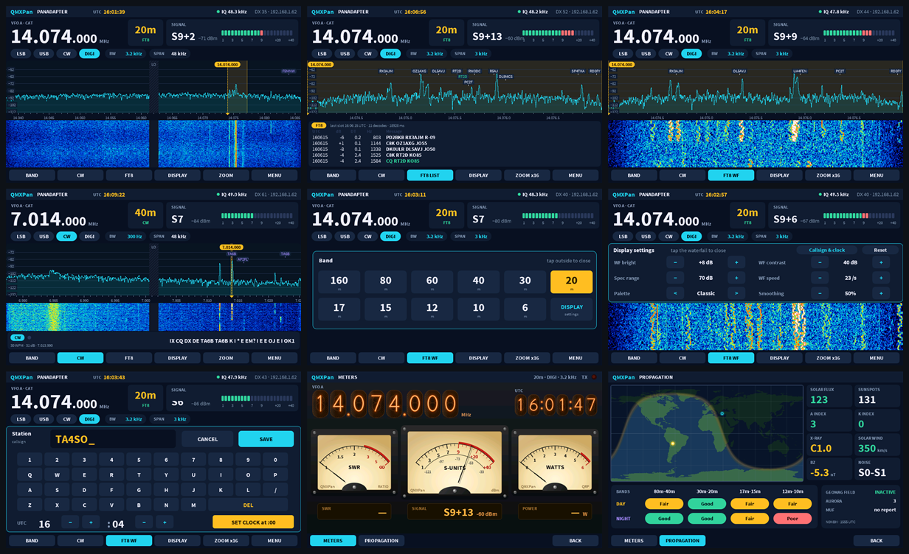
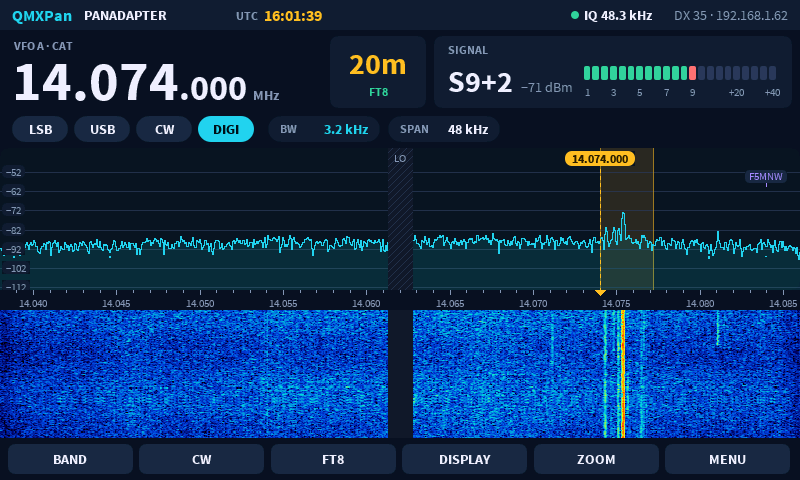
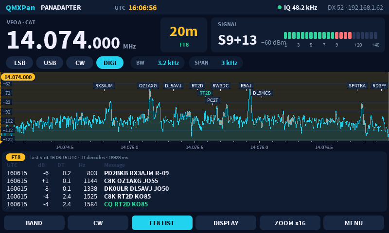
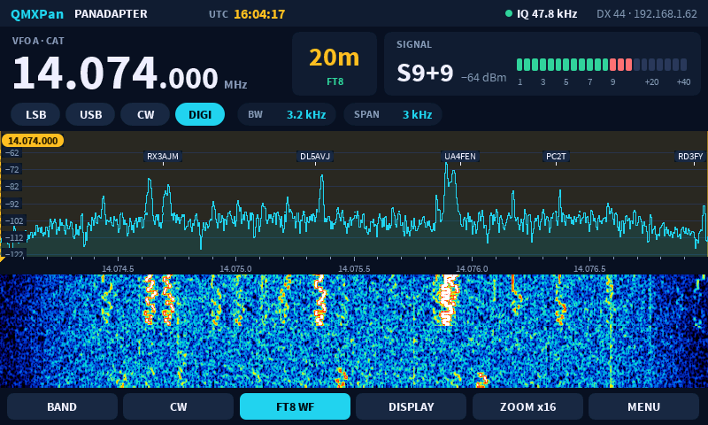
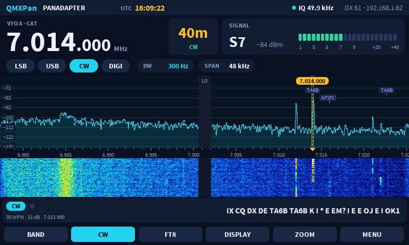
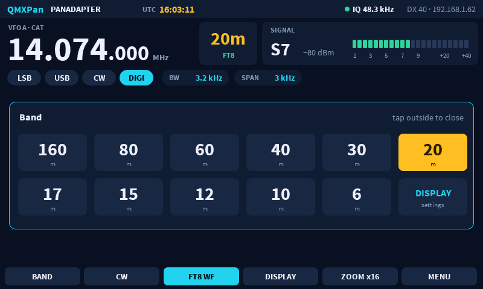
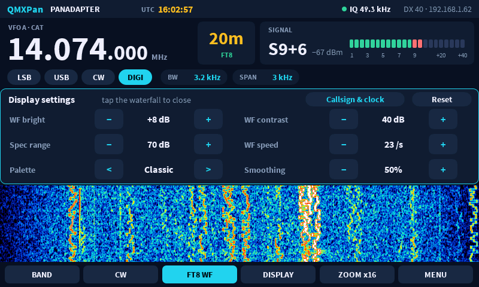
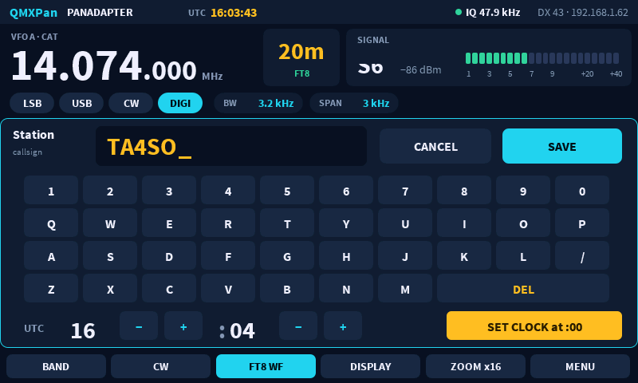
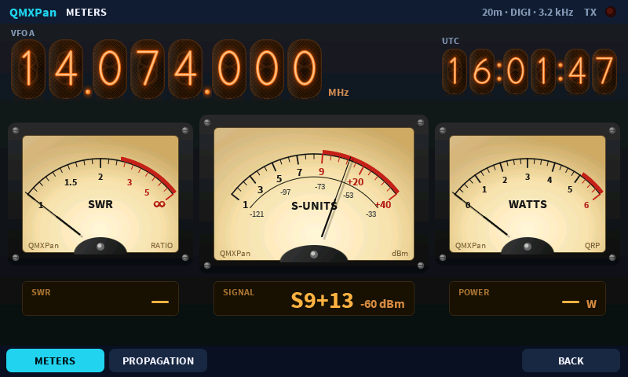
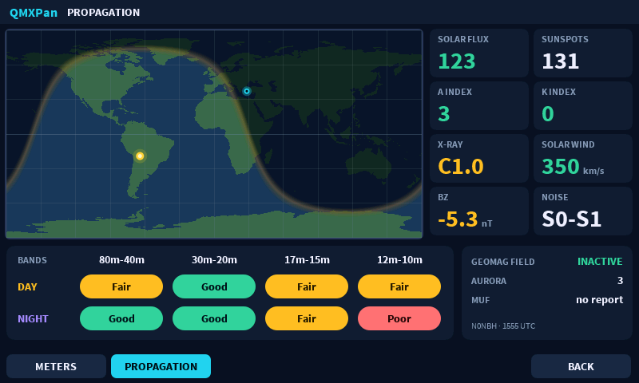

# QMXPan

A low-cost panadapter for the **QRP Labs QMX / QMX+** transceiver, running on the
**Waveshare ESP32-S3-Touch-LCD-4.3** (800×480 touch display). The board plugs into the
QMX's USB port, reads its I/Q audio and CAT port, and shows a live spectrum and waterfall.
Tap the spectrum to tune the radio.

*Türkçe: [README.tr.md](README.tr.md)*



## Features

| | Full | Lite |
|---|:-:|:-:|
| Spectrum + waterfall, zoom ×1…×16, tap/drag to tune | ✓ | ✓ |
| Band buttons with per-band frequency memory, mode chips (LSB/USB/CW/DIGI) | ✓ | ✓ |
| CW decoder, FT8 decoder (list and waterfall labels) | ✓ | ✓ |
| METERS page: analog SWR / S-meter / power meters, Nixie-style clock | ✓ | ✓ |
| UTC clock | internet (NTP) | set by hand, auto-trimmed by FT8 |
| WiFi, web settings page, firmware update over WiFi | ✓ | – |
| DX cluster spots on the spectrum | ✓ | – |
| PROPAGATION page (solar data, day/night map) | ✓ | – |

**Which one should I choose?**
- **Full** if you have WiFi where you operate.
- **Lite** for portable / field use with no WiFi.

Lite does not start any WiFi at all. That leaves more memory free and gives a simpler start-up.

## What you need

- QRP Labs QMX or QMX+ with firmware that has I/Q mode (CAT command `Q9`).
- Waveshare **ESP32-S3-Touch-LCD-4.3** (the 16 MB flash / 8 MB PSRAM version).
- USB cable: the board's **USB OTG** port goes to the QMX's USB port. The board's
  other USB port (UART) is only used for installing the firmware.
- 5 V power for the board.

> **QMX+ owners:** use the firmware made for the QMX+. The plain-QMX firmware on a QMX+
> refuses some bands; QMXPan then shows *"QMX: xx m not available"*.

## Installing

### Easiest: from the browser

1. Open the **[QMXPan installer page](https://OWNER.github.io/QMXPan/)** in Chrome or Edge on a computer.
2. Connect the board's **UART** USB port to the computer.
3. Click **Install Full** or **Install Lite**, choose the serial port, and confirm.

On a first install, tick **Erase device**. When updating, leave it unticked: your WiFi,
callsign and settings are kept.

### By hand

Download `qmxpan-full-<version>.bin` or `qmxpan-lite-<version>.bin` from the
[Releases](https://github.com/OWNER/QMXPan/releases) page and write it at address `0x0`:

```bash
espflash write-bin 0x0 qmxpan-full-0.14.0.bin
```

or

```bash
esptool.py --chip esp32s3 write_flash 0x0 qmxpan-full-0.14.0.bin
```

This single-file image also clears the stored settings.

## First start

1. Connect the board to the QMX, then power the board.
2. **Switch the QMX's 12 V off and on once.** The QMX only enumerates on USB after a power cycle.
   Do the same whenever the board restarts. QMXPan retries the USB port by itself.
3. **Full:** the board opens a WiFi network called `QMXPan-Setup`.
   1. Join it.
   2. Browse to `http://192.168.71.1`.
   3. Enter your home WiFi name and password.
   4. Once the board restarts, its IP address is shown at the top right. Open that address for settings:
      - callsign and DX cluster
      - locator for the map
      - S-meter calibration
      - firmware update
4. **Lite (or Full without WiFi):**
   1. Tap **UTC** at the top of the screen.
   2. Type your callsign.
   3. Set the hours and minutes to the *next* minute of an accurate clock.
   4. Press **SET CLOCK** exactly when that clock's seconds reach :00.

   FT8 decoding then trims the clock automatically.

The same window is also under **DISPLAY → Callsign & clock**.

## Screens

| | |
|---|---|
|  **Main screen:** 48 kHz spectrum and waterfall |  **FT8 list:** decodes, with callsigns on the spectrum |
|  **FT8 waterfall:** the FT8 sub-band at ×16 |  **CW decoder** |
|  **Band window** |  **Display settings** |
|  **Callsign & clock** |  **METERS page** |
|  **PROPAGATION page** (Full) | |

## Using it

- **Tap or drag** on the spectrum or waterfall to tune. A short tap on an FT8/DX label tunes to that station.
- Tap the **frequency** (or press **BAND**) for band buttons and **DISPLAY** settings.
- **ZOOM** steps ×1 → ×2 → ×4 → ×8 → ×16.
- **FT8** steps through: list → waterfall with labels → off. The waterfall view zooms to the FT8 sub-band.
- **CW** shows the CW decoder.
- **MENU** opens the METERS page, and on Full also the PROPAGATION page.

## Updating

- **Full:** on the board's web page, choose `qmxpan-full-ota-<version>.bin` and press **Upload**.
  If the first attempt drops the connection, the page retries by itself.
- **Lite:** use the installer page again, leaving *Erase device* unticked.

## Building from source

- Rust `esp` toolchain ([espup](https://github.com/esp-rs/espup)), `ldproxy` and `espflash`.
- ESP-IDF v5.4.2 is downloaded automatically by `esp-idf-sys`.

```bash
cargo build --release
```

```bash
cargo build --release --no-default-features
```

The first command builds Full; the second builds Lite. `tools/package.ps1` builds both
and writes all release files to `dist/`.

> `sdkconfig.defaults` holds an absolute path to `partitions.csv`
> (`CONFIG_PARTITION_TABLE_CUSTOM_FILENAME`). Change it to your checkout path.

## Credits

- [ft8_lib](https://github.com/kgoba/ft8_lib) by Karlis Goba (MIT): FT8 decoding.
- Solar data: [N0NBH, hamqsl.com](https://www.hamqsl.com/solar.html) (Full only).
- Map: [Natural Earth](https://www.naturalearthdata.com/) (public domain).
- Fonts: Source Sans Pro (SIL Open Font License 1.1).
- Espressif ESP-IDF and the esp-rs crates.

QMX and QMX+ are products of QRP Labs. QMXPan is an independent project and is not
affiliated with QRP Labs.

## License

MIT, see [LICENSE](LICENSE). The bundled ft8_lib (`components/ft8_lib`) keeps its own MIT license.
